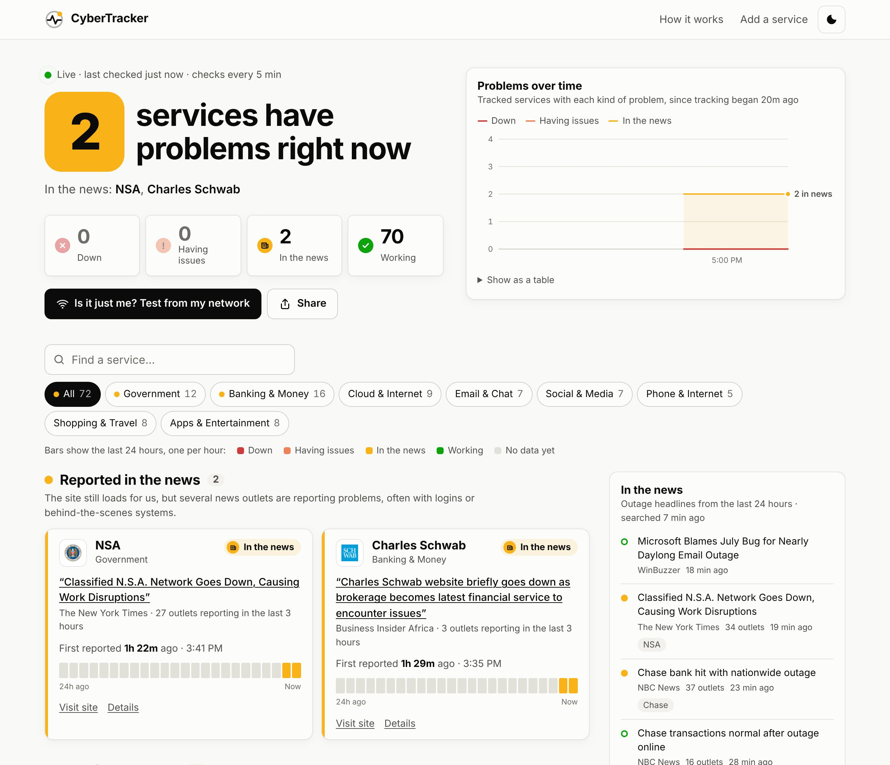

# CyberTracker: what's down right now

A live, plain-English tracker of which banks, government sites, cloud services and apps are having problems. Anyone can open it and see in a few seconds what's broken, since when, and what the news is saying.



**Live site:** https://hturcotte1.github.io/cybertracker/ (once GitHub Pages is turned on, see [Setup](#setup))

## What it shows

Every service gets one of four statuses:

| Status | What it means |
| --- | --- |
| 🔴 **Down** | Our robot can't load the site at all (no answer, or a server error), even after a retry. |
| 🟠 **Having issues** | Part of it fails (often the sign-in page), it's very slow, or the company's own status page reports a major outage. |
| 🟡 **In the news** | The site loads, but at least two news outlets reported problems in the last 3 hours, and no newer story says it's fixed. This catches outages a homepage check can't see, like a bank's logins failing or an agency's internal network going down. |
| 🟢 **Working** | Everything we check answers. |

The page also has:

- **A headline number**: how many services have problems right now, and which ones.
- **A chart** of problems over the last 24 hours, plus a 24-hour history bar on every service.
- **"In the news"**: outage headlines from the last day, with duplicate copies of the same story grouped together.
- **"Status changes"**: what went down or came back, and when.
- **"Is it just me?"**: tries every site from the visitor's own browser. If most fail for them but not for us, it's their connection.
- **Share links**: for the whole page, or one service (`…/#s/charles-schwab`).
- Light and dark mode, phone layout, and keyboard and screen-reader support.

## How it works

```
every ~5 min  ┌───────────────────────┐   site/data/status.json   ┌──────────────────┐
  GitHub ───▶ │ scripts/check.mjs     │ ────────────────────────▶ │ site/ (GitHub    │
  Actions     │ • loads each site     │   committed to the repo   │ Pages) reads it  │
              │ • reads status pages  │                           │ and refreshes    │
              │ • searches the news   │                           │ every minute     │
              └───────────────────────┘                           └──────────────────┘
```

- `services.json`: the list of what to track. Edit this to add or remove services.
- `scripts/check.mjs`: the checker. Node 20+, no dependencies.
- `scripts/lib.mjs`: the rules (what counts as down, how headlines are matched). Tested in `scripts/lib.test.mjs`.
- `site/`: the website: plain HTML, CSS and JavaScript, no build step.
- `.github/workflows/monitor.yml`: runs the checker every 5 minutes, saves results, and publishes the site.

News comes from Google News search. It's refreshed at most every 10 minutes and matched to services by name, using the `news` terms in `services.json`.

Results are saved as small commits by `github-actions[bot]` every few minutes, so the repo's history fills up with "Status: …" commits. That's expected, and it means the history is public and auditable.

## Setup

The repo has to be **public**: GitHub Pages and unlimited Actions minutes are free for public repos.

1. Go to **Settings → Pages**. Under *Build and deployment*, set **Source** to **GitHub Actions**.
2. Go to **Actions → Monitor → Run workflow** to publish right away. Otherwise the next scheduled run (within ~5 minutes) does it.
3. Open **https://hturcotte1.github.io/cybertracker/**.

The workflow starts collecting data as soon as this code is on the repo's default branch, even before Pages is on. It publishes the site once Pages is set to GitHub Actions.

> **Default branch:** scheduled runs only happen on the repo's default branch. Because this repo started empty, the first branch pushed to it became the default. You can rename it to `main` under **Settings → Branches**; the workflow works with any branch name.

GitHub's scheduler sometimes runs late or stalls, especially on new repos. When no scheduled run has happened for 12 minutes, the workflow's backup timer (the `keepalive` job) starts the next check itself, so checks keep running about every 5 minutes either way. The page shows when the last check finished and warns visitors if results are more than 20 minutes old.

## Add or change a service

Edit `services.json`. GitHub's web editor works fine. The smallest entry is:

```json
{ "name": "Charles Schwab", "category": "Banking & Money", "url": "https://www.schwab.com" }
```

Optional fields:

| Field | Example | What it does |
| --- | --- | --- |
| `checks` | `{ "Website": "https://www.schwab.com", "Sign-in": "https://client.schwab.com/…" }` | Pages to load. If all fail it's **Down**; if some fail it's **Having issues**. Defaults to just `url`. Use `false` to skip site checks and rely on news (good for phone networks). |
| `statusPage` | `"https://www.githubstatus.com"` | The company's status page. Shown as a link, and read automatically if it's an Atlassian Statuspage (most are). |
| `news` | `["Schwab", "thinkorswim"]` | Names to look for in headlines. Defaults to `name`. Use specific phrases for common words (`"Delta Air Lines"`, not `"Delta"`). `false` turns news off for that service. |
| `note` | `"Checks the website, not the phone network."` | A short note shown on the service. |
| `manual` | `{ "status": "down", "note": "Schwab confirmed a login outage at 10:30 AM ET." }` | Overrides the status, labeled "Confirmed by the tracker maintainer". Remove it when it's over. |
| `id` | `"schwab"` | Used in share links. Defaults to a slug of `name`. |

To pin a message at the top of the page, set `"notice"` in the `site` block, for example `"notice": "Widespread outages reported across banks and government sites."`.

People can suggest services with the **Add a service** link on the site. It opens a GitHub issue form.

## Run it locally

```bash
npm test
```

```bash
node scripts/check.mjs --dry-run
```

```bash
node scripts/check.mjs && npm run serve
```

`--dry-run` prints results without saving anything, and `--only=nsa,charles-schwab` checks just those. The last command writes `site/data/status.json` and serves the site at http://localhost:8080.

## Limits

- Checks run from GitHub's cloud servers in the US, about every 5 minutes. A regional outage elsewhere may not show up.
- Sites that block robots but still answer (403, 429, bot walls) count as working. That avoids false alarms, but a site that's broken behind its bot wall can look up. The sign-in checks and news reports help cover that gap.
- Headline matching uses keywords, not judgment. Every news-based status shows the headline and a link, so readers can judge for themselves. If something's wrong, the **Wrong status? Tell us** button in each service's details opens an issue.
- The status-page reader only understands the common Atlassian Statuspage format. Other status pages are linked, not read.
- CyberTracker is independent and isn't affiliated with any company or agency listed.
